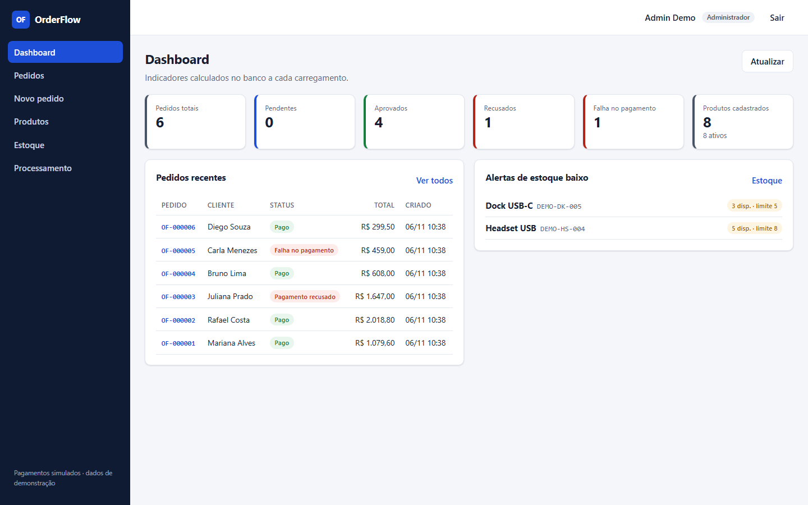
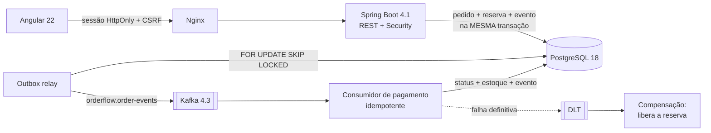
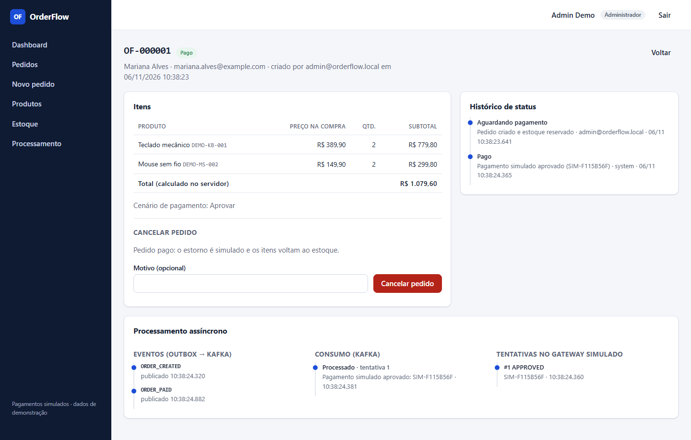
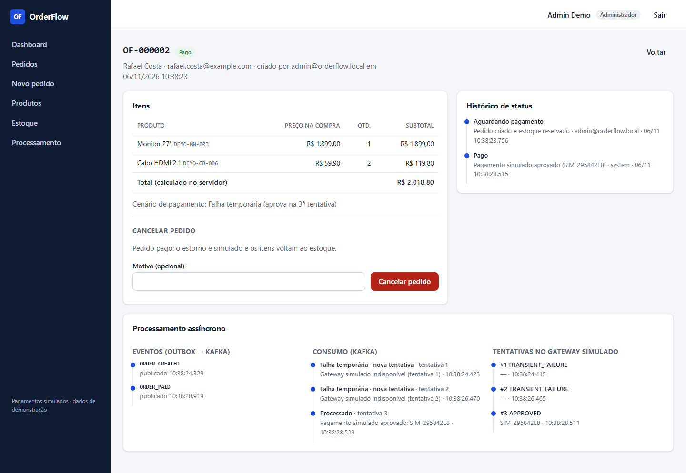
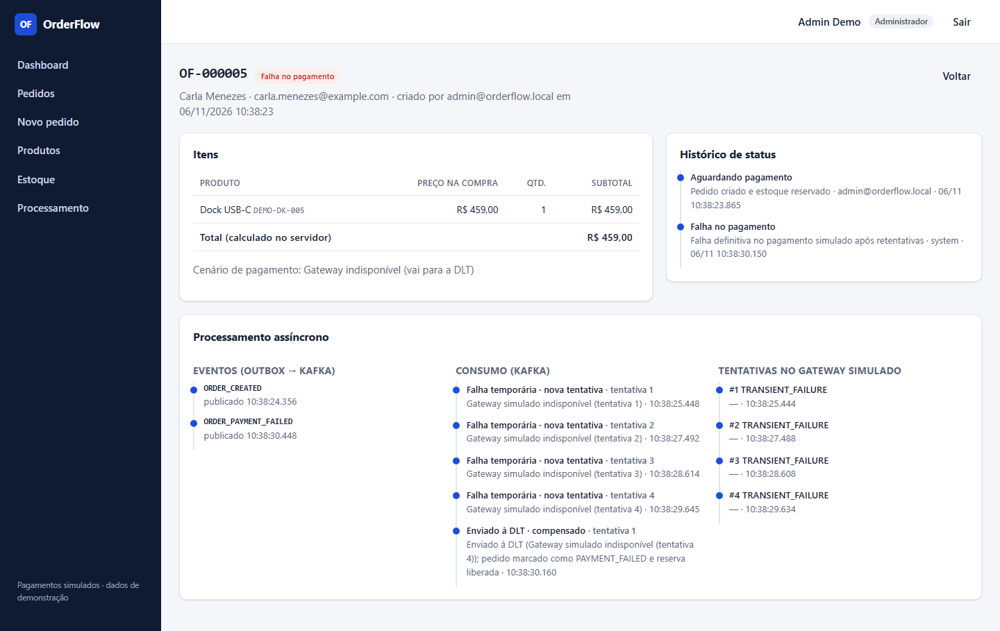
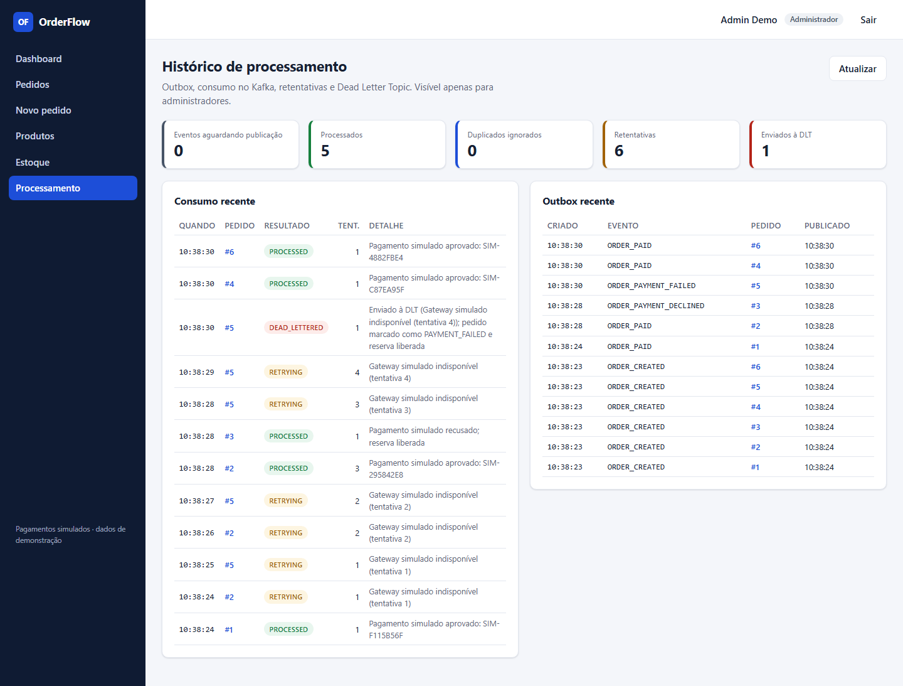
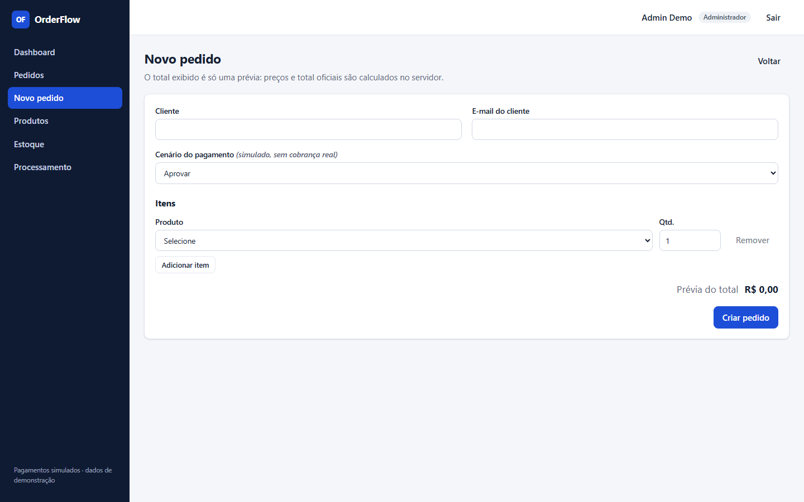
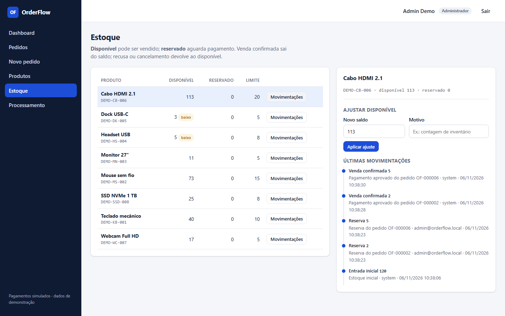
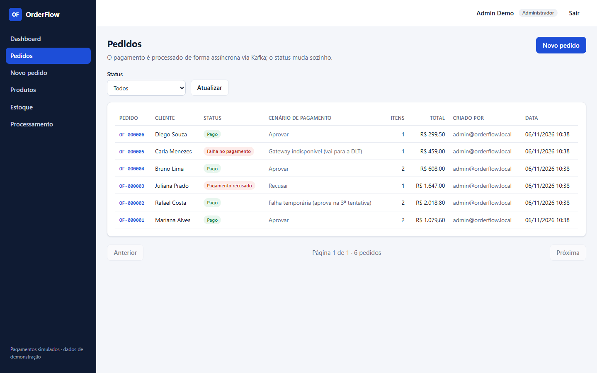
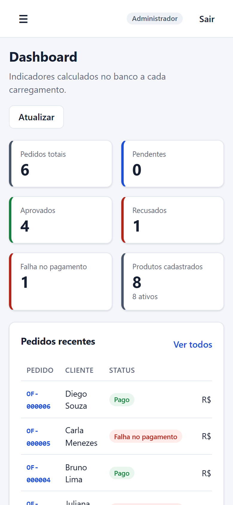

# OrderFlow

[](https://github.com/caiorocha7/orderflow-java/actions/workflows/ci.yml)
    

**Plataforma de gestão de pedidos e estoque** com backend Java/Spring Boot, processamento assíncrono via Apache
Kafka, transações PostgreSQL, controle de concorrência na reserva de estoque e idempotência de ponta a ponta.

> 🇺🇸 [English version below](#english)



## O problema

Uma empresa precisa vender produtos com estoque limitado. Quando dois clientes compram a última unidade ao mesmo
tempo, quando o pagamento demora ou falha, ou quando uma mensagem é entregue duas vezes, o sistema não pode vender
o que não tem, cobrar duas vezes nem deixar estoque preso em pedidos que nunca serão pagos.

## O que o OrderFlow faz

| Área | Funcionalidades |
|---|---|
| Autenticação | Login por sessão (cookie HttpOnly), senhas com BCrypt, papéis `ADMIN` e `OPERATOR`, CSRF, rotas protegidas |
| Produtos | CRUD com SKU único, preço não negativo, status, limite de estoque baixo e controle de versão |
| Estoque | Disponível × reservado, ajuste manual com motivo, trilha de movimentações (reserva, consumo, liberação, devolução) |
| Pedidos | Vários itens, total calculado no servidor, preço congelado na compra, filtro por status, histórico, cancelamento |
| Pagamento | Gateway **simulado** com cenários de aprovação, recusa, falha temporária e indisponibilidade |
| Mensageria | Transactional Outbox → Kafka → consumidor idempotente, retry com backoff, Dead Letter Topic e compensação |
| Operação | Dashboard com indicadores do banco, alertas de estoque baixo, histórico de processamento assíncrono |

## Arquitetura

Monólito modular (Spring Boot) com integração **real** ao Kafka. Não é um sistema de microsserviços: o Kafka separa
a criação do pedido do processamento do pagamento no tempo, com garantias de entrega, dentro de um único backend.



Detalhes, diagramas de sequência, máquina de estados e modelo de dados: **[docs/ARCHITECTURE.md](docs/ARCHITECTURE.md)**.
Decisões e trade-offs: **[docs/DECISIONS.md](docs/DECISIONS.md)**.

### Fluxo de um pedido

1. `POST /api/orders` bloqueia as linhas dos produtos (`SELECT ... FOR UPDATE`, sempre em ordem de id), valida o
   saldo, reserva o estoque, grava o pedido com o preço de cada item e o evento `ORDER_CREATED` no **outbox**, tudo
   em uma transação.
2. O **relay** lê o outbox com `FOR UPDATE SKIP LOCKED`, publica no tópico `orderflow.order-events` (chave = id do
   pedido) e marca o evento como publicado.
3. O **consumidor de pagamento** bloqueia o pedido, verifica se o evento já foi processado, chama o gateway simulado e,
   na mesma transação, muda o status, consome ou libera a reserva, grava o próximo evento e marca o evento como
   processado.
4. **Falha temporária:** retentativa com backoff (3 por padrão). **Esgotou:** a mensagem vai para a DLT e um consumidor
   dedicado marca `PAYMENT_FAILED` e devolve a reserva ao estoque.

### Concorrência

- Reserva com lock pessimista e ordem fixa de bloqueio (sem deadlock entre pedidos com produtos em ordem inversa).
- Transições de status com lock no pedido: pagamento e cancelamento simultâneos não se atropelam.
- Edição de produto com `@Version` (409 se outra pessoa alterou antes).
- `CHECK (available_quantity >= 0)` no banco como última defesa.

### Idempotência

| Onde | Como |
|---|---|
| Criação do pedido | Header `Idempotency-Key` + `UNIQUE` no banco: duplo clique ou retry devolvem o mesmo pedido |
| Consumidor Kafka | `processed_message (consumer, event_id)` gravado na mesma transação do efeito |
| Relay | `SKIP LOCKED` evita publicação paralela; reenvio após falha é absorvido pelo consumidor |
| DLT | A compensação também é idempotente e ignora pedidos que já não estão pendentes |

## Tecnologias

| Camada | Stack |
|---|---|
| Backend | Java 21, Spring Boot 4.1 (Web MVC, Data JPA, Security, Validation, Kafka, Actuator), Flyway, springdoc OpenAPI |
| Dados e mensageria | PostgreSQL 18, Apache Kafka 4.3 (KRaft, sem ZooKeeper) |
| Frontend | Angular 22 (standalone, signals, zoneless), TypeScript, formulários reativos validados |
| Testes | JUnit 5, Mockito, Testcontainers (PostgreSQL e Kafka reais), Awaitility, Vitest, Playwright |
| Infra e qualidade | Docker, Docker Compose, Nginx, GitHub Actions, gitleaks, npm audit, Dependabot, logs estruturados (ECS) |

## Como executar

Pré-requisito: **Docker** (com Docker Compose). Nada mais precisa estar instalado.

```bash
git clone https://github.com/caiorocha7/orderflow-java.git
cd orderflow-java
cp .env.example .env          # opcional: os padrões já funcionam localmente
docker compose up -d --build --wait
```

| Serviço | Endereço |
|---|---|
| Aplicação | http://localhost:8081 |
| API + Swagger | http://localhost:8088/swagger-ui.html |
| Health check | http://localhost:8081/actuator/health |
| PostgreSQL | `localhost:5435` |
| Kafka (externo) | `localhost:9094` |

**Usuários de demonstração** (criados pelo seed; as senhas vêm do `.env` e são gravadas como hash BCrypt):

| Papel | E-mail | Senha padrão |
|---|---|---|
| Administrador | `admin@orderflow.local` | `Admin@Demo2026` |
| Operador | `operator@orderflow.local` | `Operador@Demo2026` |

Produtos de demonstração têm SKU `DEMO-*`. Para ver cada caminho do pagamento, crie pedidos escolhendo o cenário:
*Aprovar*, *Recusar*, *Falha temporária* (aprova na 3ª tentativa) ou *Gateway indisponível* (vai para a DLT).

Encerrar e limpar:

```bash
docker compose down        # para os contêineres e mantém os dados
docker compose down -v     # remove também os volumes (banco e Kafka zerados)
```

## Testes

| Suíte | Ferramenta | Quantidade | O que comprova |
|---|---|---:|---|
| Unitários (backend) | JUnit 5 | 25 | Cálculo de valores, máquina de estados, regras de estoque, cenários do gateway simulado |
| Integração (backend) | Testcontainers: PostgreSQL 18 + Kafka 4.3 | 31 | Ver tabela abaixo |
| Unitários (frontend) | Vitest | 9 | Fluxo CSRF antes do login, mensagens de erro, envio só de ids e quantidades, Idempotency-Key |
| E2E | Playwright contra o docker compose | 10 | Fluxos reais no navegador, inclusive Kafka, cancelamento, autorização e layout mobile |

Testes de integração (sem mocks de banco nem de broker):

- criação válida com total e preço congelado; dados inválidos (400 por campo); valores do cliente ignorados;
- falta de estoque em um item não reserva nenhum outro; produto inexistente (404);
- **20 compras simultâneas disputando 5 unidades vendem exatamente 5**; quantidades diferentes nunca passam do saldo;
  pedidos com produtos em ordem inversa não entram em deadlock;
- pagamento aprovado (reserva consumida), recusado (reserva liberada), falha temporária retentada até aprovar,
  **falha definitiva → DLT → `PAYMENT_FAILED` com estoque devolvido**;
- **mensagem duplicada no Kafka não cobra nem baixa estoque duas vezes**; mensagem malformada vai para a DLT sem
  travar o consumidor; cancelamento de pedido pendente e de pedido pago;
- autenticação (401, senha errada com mensagem genérica, BCrypt), CSRF obrigatório, autorização por papel, operador não
  cancela pedido de outra pessoa, SKU duplicado e versão desatualizada (409).

Como rodar:

```bash
cd backend && ./mvnw verify                 # unitários + integração (precisa de Docker)
cd frontend && npm ci && npx ng test --watch=false
cd e2e && npm ci && npx playwright install chromium && npx playwright test   # com a stack no ar
```

## Capturas de tela

Capturas reais da aplicação rodando via docker compose (geradas por `e2e/capture-screenshots.mjs`).

| | |
|---|---|
|  Pedido pago e linha do tempo assíncrona |  Falha temporária retentada até aprovar |
|  Falha definitiva: DLT e compensação |  Histórico de processamento (admin) |
|  Novo pedido com vários itens |  Estoque e movimentações |
|  Pedidos com filtro por status |  Layout mobile |

## Limitações conhecidas

- **Pagamento simulado:** não há integração com meio de pagamento; o cenário é escolhido no pedido para demonstração.
- Instância única do backend: sessões em memória (para escalar, Spring Session com Redis ou PostgreSQL).
- Retentativas bloqueantes seguram a partição durante o backoff; `processed_message` e `outbox_event` não têm rotina
  de limpeza.
- Kafka com um único broker e fator de replicação 1 (adequado para ambiente local, não para produção).
- Sem métricas (Prometheus) nem tracing distribuído; há health checks, readiness e logs estruturados.
- Sem limitação de tentativas de login.

## Melhorias futuras

- Tópicos de retry não bloqueantes (`@RetryableTopic`) e reprocessamento manual da DLT pela interface.
- Métricas com Micrometer/Prometheus (latência do outbox, lag do consumidor) e tracing com OpenTelemetry.
- Expiração automática de reservas de pedidos pendentes há muito tempo.
- Spring Session, rate limit no login e auditoria de alterações de produto.

## Estrutura

```
backend/    Spring Boot (catalog, ordering, payment, messaging, auth, dashboard), Flyway, testes
frontend/   Angular 22 (páginas, core, shared) + Nginx
e2e/        Playwright + script de capturas de tela
docs/       Arquitetura, decisões técnicas, screenshots
```

---

## English

**OrderFlow** is an order and inventory management platform built with **Java 21 and Spring Boot 4.1**, using
**Apache Kafka** for asynchronous processing, **PostgreSQL** transactions, concurrency control on stock reservations
and end-to-end idempotency. It is a portfolio project: payments are **simulated** and all data is demo data.

**Highlights**

- **Concurrency:** stock rows are locked with `SELECT ... FOR UPDATE` in a fixed order. An integration test fires
  20 concurrent purchases for 5 units and asserts exactly 5 succeed, against a real PostgreSQL.
- **Transactional Outbox:** the order, the stock reservation and the `ORDER_CREATED` event are committed in one
  transaction. A relay publishes to Kafka using `FOR UPDATE SKIP LOCKED` (at-least-once delivery).
- **Idempotent consumer:** a `processed_message (consumer, event_id)` row is written in the same transaction as the
  effect, so duplicated Kafka messages never charge or deduct stock twice (covered by a test that re-sends the message).
- **Retries and DLT:** transient gateway failures are retried with backoff; exhausted messages go to a Dead Letter
  Topic whose consumer marks the order `PAYMENT_FAILED` and releases the reservation (compensation).
- **Security:** session cookie (HttpOnly, no tokens in `localStorage`), SPA-mode CSRF, BCrypt, role-based access,
  optimistic locking on product edits, RFC 9457 error responses.
- **Tests:** 25 backend unit tests, 31 integration tests with Testcontainers (PostgreSQL 18 and Kafka 4.3),
  9 frontend unit tests (Vitest) and 10 Playwright end-to-end tests against the Docker Compose stack, all in CI.

It is a **modular monolith**, not microservices: Kafka decouples order creation from payment processing in time,
within a single deployable backend. See [docs/ARCHITECTURE.md](docs/ARCHITECTURE.md) and
[docs/DECISIONS.md](docs/DECISIONS.md) (in Portuguese) for diagrams and trade-offs.

**Run it:** `docker compose up -d --build --wait`, then open http://localhost:8081 and sign in with
`admin@orderflow.local` / `Admin@Demo2026` (demo credentials defined in `.env.example`).

**Known limitations:** simulated payment gateway, single backend instance with in-memory sessions, single Kafka
broker, blocking retries, no metrics or tracing yet.

## Licença / License

MIT. Projeto pessoal de portfólio, sem relação com sistemas de empregadores atuais ou anteriores.
