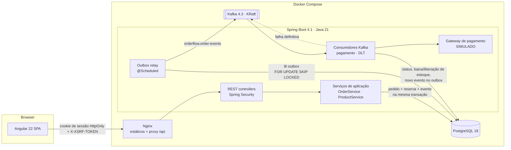
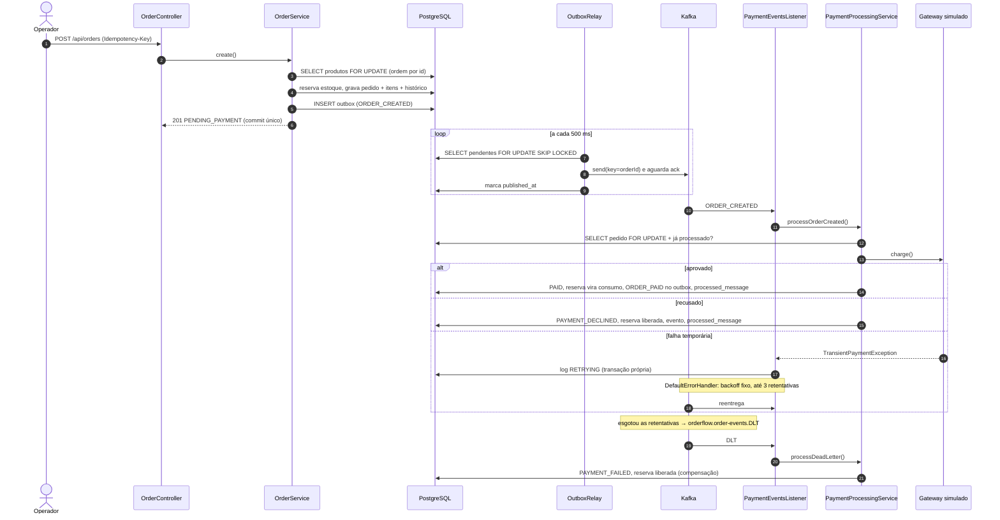
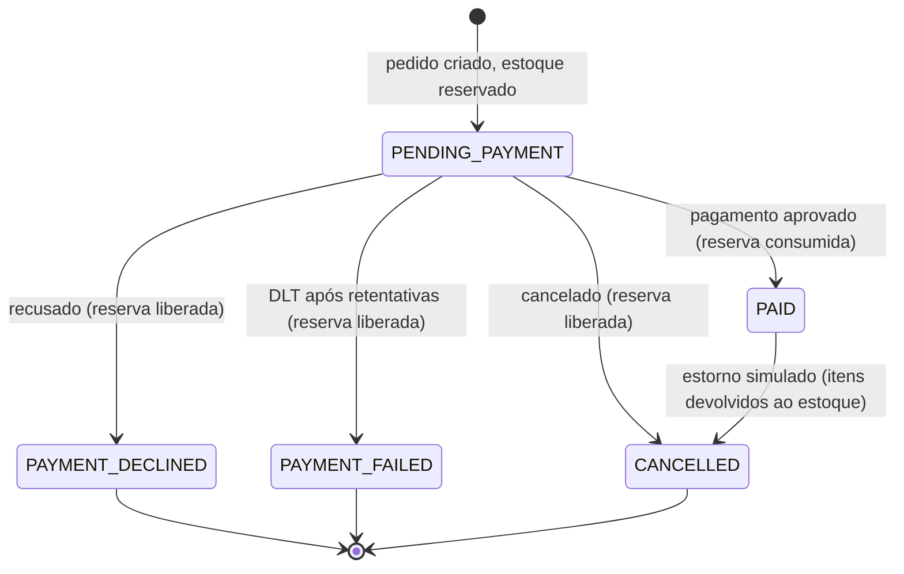
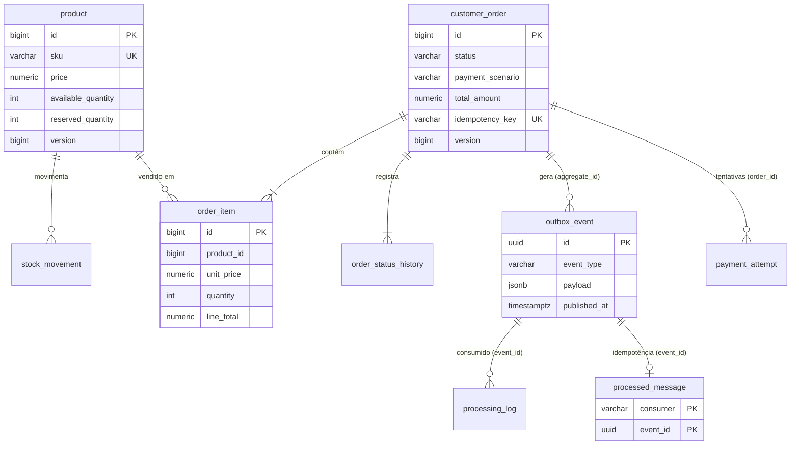

# Arquitetura

## Visão geral

O OrderFlow é um **monólito modular** em Spring Boot com integração real ao Apache Kafka. Não é um sistema de
microsserviços: há um único backend implantável. O Kafka separa *quando* cada etapa acontece (criação do pedido
× pagamento), não em quais serviços ela roda. A divisão em módulos deixa claro onde cada fronteira estaria se um
dia o pagamento virasse um serviço independente.

## Módulos

| Pacote | Responsabilidade | Camadas |
|---|---|---|
| `catalog` | Produtos e saldo de estoque (disponível, reservado), movimentações | domain · application · infrastructure · web |
| `ordering` | Pedido (agregado), itens com preço congelado, máquina de estados, histórico | domain · application · infrastructure · web |
| `payment` | Port `PaymentGateway`, adapter simulado, processamento idempotente do pagamento | port + adapter + serviço |
| `messaging` | Outbox, relay para o Kafka, consumidores, idempotência, log de processamento, DLT | infraestrutura de integração |
| `auth` | Usuários, BCrypt, sessão, CSRF, CORS, papéis | segurança |
| `dashboard` | Indicadores consultados no banco | leitura |
| `demo` | Seed opcional de usuários e produtos `DEMO-*` | dados de demonstração |

**Ports e adapters onde há troca real de tecnologia:** `OrderEventPublisher` (aplicação) é implementado pelo outbox;
`PaymentGateway` (aplicação) é implementado pelo gateway simulado. O domínio (`Order`, `Product`, `OrderStatus`) não
conhece Spring, Kafka nem HTTP, só JPA para mapeamento. Não criei interfaces para repositórios: o Spring Data já
é a abstração, e uma camada extra só duplicaria código.

## Fluxo de um pedido

## Máquina de estados

Toda mudança passa por `Order.transitionTo`, que valida a transição com `OrderStatus.canTransitionTo` e registra o
histórico. Transições inválidas lançam `DomainException(INVALID_TRANSITION)` sem alterar o pedido.

## Modelo de dados

Regras críticas também existem no banco: `CHECK (available_quantity >= 0)`, `CHECK (price >= 0)`, `UNIQUE (sku)`,
`UNIQUE (idempotency_key)`, `UNIQUE (order_id, product_id)` e a PK composta de `processed_message`.

## Segurança

- Sessão por cookie `JSESSIONID` **HttpOnly** e `SameSite=Lax`; nenhum token em `localStorage`.
- CSRF em modo SPA: cookie `XSRF-TOKEN` legível + header `X-XSRF-TOKEN` em toda escrita.
- Senhas com BCrypt (`DelegatingPasswordEncoder`); mensagem de login genérica; e-mail não vai para o log.
- Autorização por papel (`ADMIN`, `OPERATOR`) com `@PreAuthorize`; operador só cancela os próprios pedidos.
- Controle otimista de versão na edição de produto (409 em edição concorrente).
- Erros em RFC 9457, sem stack trace; CSP, `X-Frame-Options`, `Referrer-Policy` no backend e no Nginx.
- Em Docker, frontend e API ficam na mesma origem (Nginx). O CORS só libera `localhost:4200` para desenvolvimento,
  e o backend usa `X-Forwarded-Host` para reconhecer a origem real atrás do proxy.
- CI com varredura de segredos (gitleaks) e `npm audit`; Dependabot para Maven, npm, Docker e Actions.
